> **Heads up:** Morphe is basically the same thing as ReVanced. I switched this tutorial to Morphe because it gets updates more often and faster. It is made by former members of the ReVanced team, not the current ReVanced team, so it is an independent successor built on ReVanced's code.
{: .prompt-warning }

## What you need

- An Android phone running Android 9 or later
- About 5-10 minutes
- **Morphe Manager** (the patcher app)
- An **unpatched YouTube APK**, version `21.20.405` (the version Morphe asks for)
- **MicroG RE** (so you can sign in to Google)

## The quick version

If you already know how this works, here is the whole thing in seven lines:

1. Install Morphe.
2. Download the unpatched YouTube APK from APKMirror. Do not install it.
3. Open Morphe, choose YouTube, and select the APK.
4. Patch it, then install the patched app.
5. Install MicroG RE.
6. Disable battery optimization for MicroG RE.
7. Sign in to your Google account.

The rest of this post is the same thing with pictures and explanations.

## Step 1: Install Morphe

Go to [morphe.software](https://morphe.software) and tap **Download Morphe**.

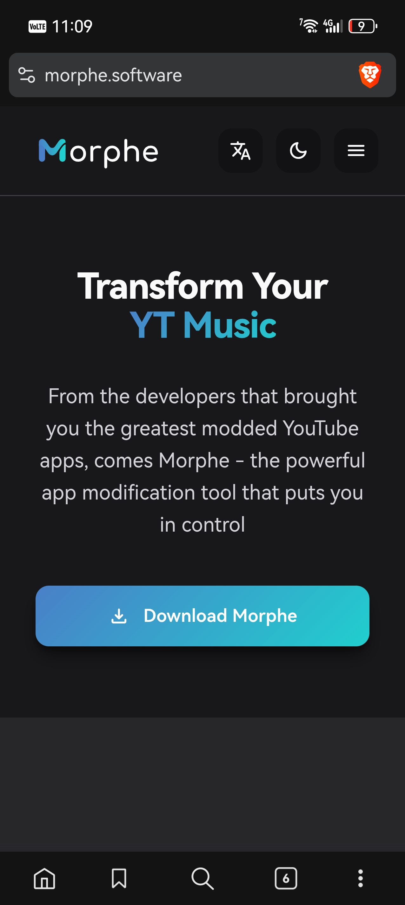{: .w-75 .shadow .rounded-10 }

Install the APK like any other app. If your phone warns you about installing from an unknown source, allow it for your browser.

When it finishes, you should see the Morphe icon on your home screen.

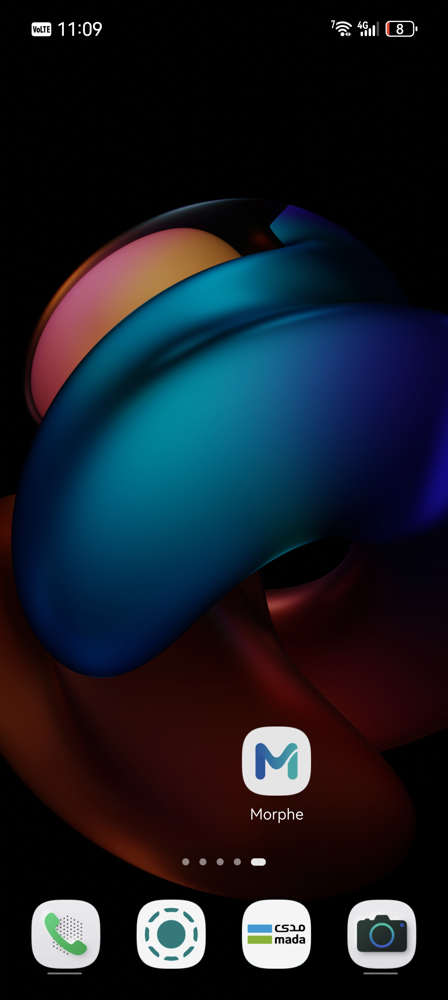{: .w-75 .shadow .rounded-10 }

Open it and you will land on the Morphe home screen. Mine had a Halloween theme with the title "Trick or patch?" when I took these screenshots, so do not worry if yours looks different. The layout is the same.

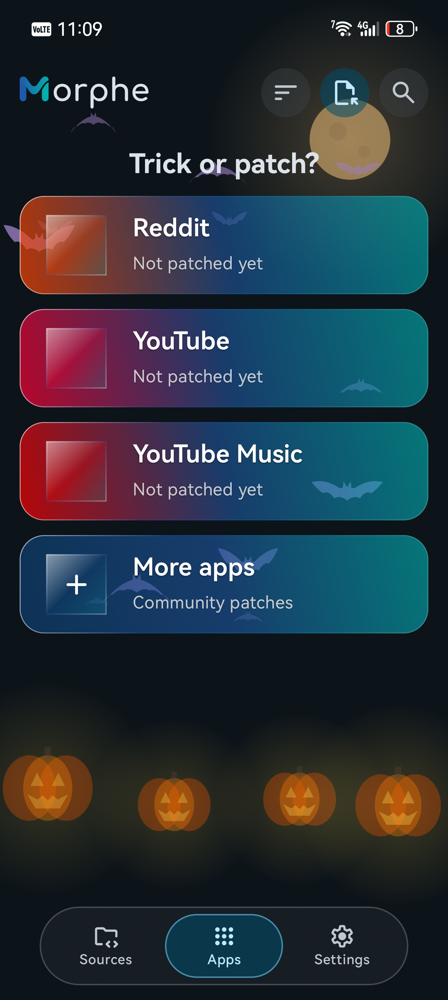{: .w-75 .shadow .rounded-10 }

You will see YouTube, YouTube Music, and Reddit, all marked "Not patched yet". We are only doing YouTube today.

## Step 2: Get the unpatched YouTube APK

Morphe does not give you a finished YouTube app. You download the official YouTube APK yourself, and Morphe modifies your copy.

Tap **YouTube** in Morphe. It will tell you it needs an original, unpatched APK, and it will show the exact version it supports. In my case it was `21.20.405`.

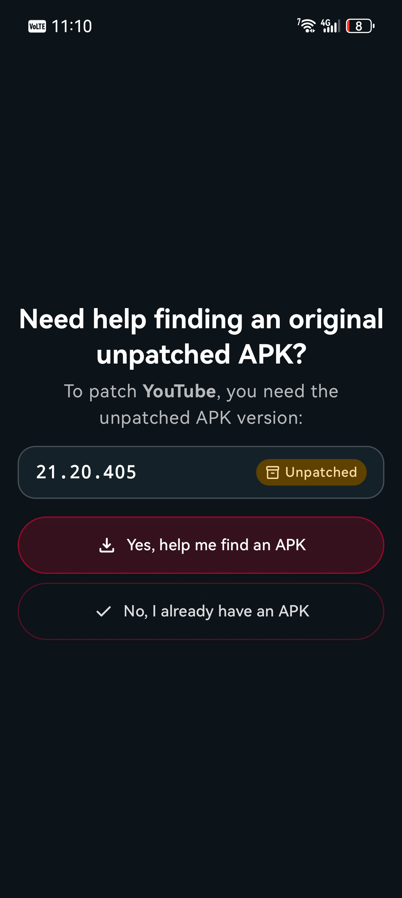{: .w-75 .shadow .rounded-10 }

Tap **Yes, help me find an APK**. Morphe gives you the steps and a button to continue to APKMirror.

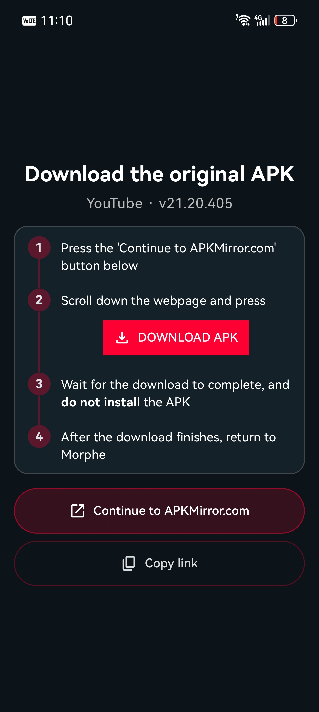{: .w-75 .shadow .rounded-10 }

On APKMirror, scroll down and tap the **DOWNLOAD APK** button. The file is around 177 MB for this version.

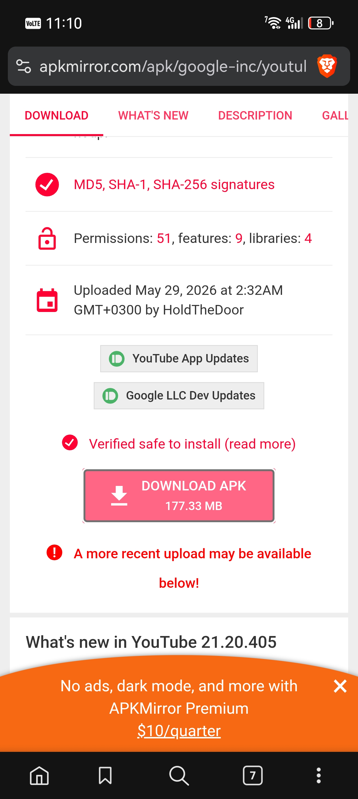{: .w-75 .shadow .rounded-10 }

Then wait for the download to finish.

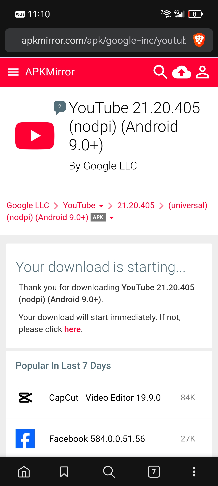{: .w-75 .shadow .rounded-10 }

> **Do not install the APK.** This is the most common mistake. Morphe needs the untouched file. If you install it, you will have a normal YouTube app and nothing to patch.
{: .prompt-warning }

Once the download is done, go back to Morphe.

## Step 3: Patch YouTube

Morphe now asks you to select the APK you just downloaded.

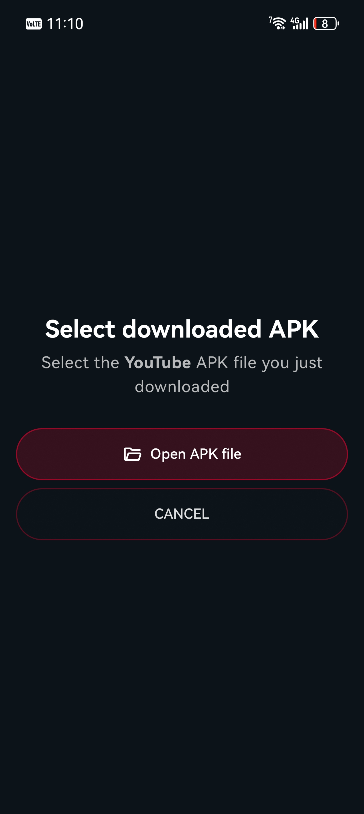{: .w-75 .shadow .rounded-10 }

Tap **Open APK file**, then find the YouTube APK in your Downloads folder.

Morphe will start patching. 

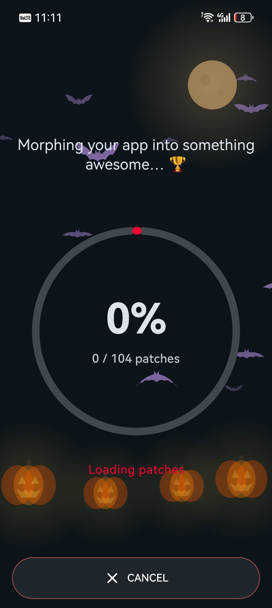{: .w-75 .shadow .rounded-10 }

Keep the app open and let it finish. Depending on your phone, this can take a few minutes. When it is done, you will see the patched YouTube screen with the version, the number of patches, and the patch source.

In my case it was:

- Version: `v21.20.405`
- Patches: `104 patches`
- Source: `Morphe Patches 1.48.0`

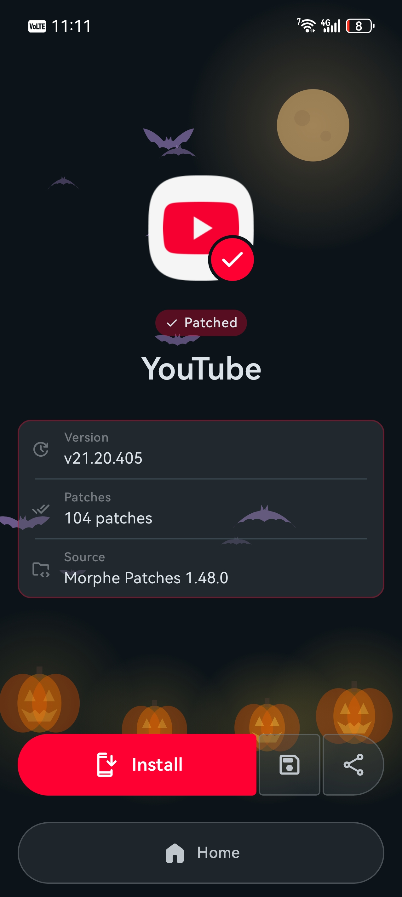{: .w-75 .shadow .rounded-10 }

## Step 4: Install the patched app

Tap **Install**.

I also saved a copy of the patched APK, just in case I needed to reinstall it later without patching again. If you want to do that too, tap the save icon next to the Install button.

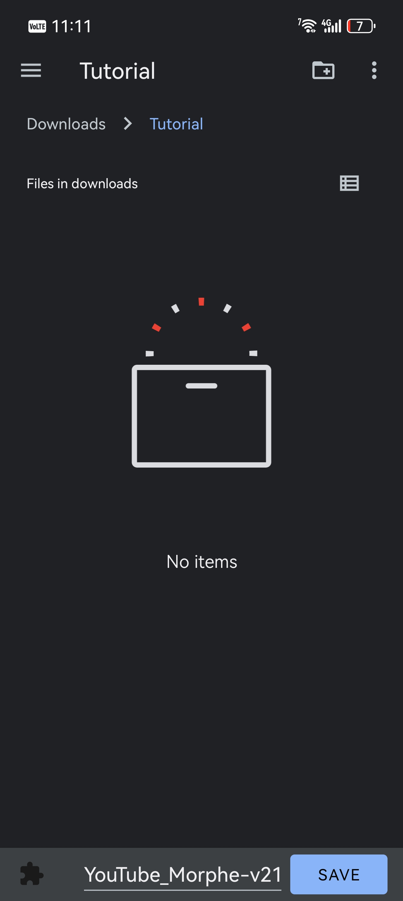{: .w-75 .shadow .rounded-10 }

Pick a folder, for example `Downloads/APKs`, and hit **SAVE**. You will get a small "APK Saved" confirmation.

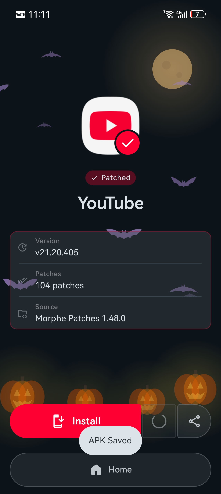{: .w-75 .shadow .rounded-10 }

If you go back to the app list, you can see the patched app details. The package is `app.morphe.android.youtube`, and the original package it came from is `com.google.android.youtube`. That is normal, because the patched app is treated as a separate app.

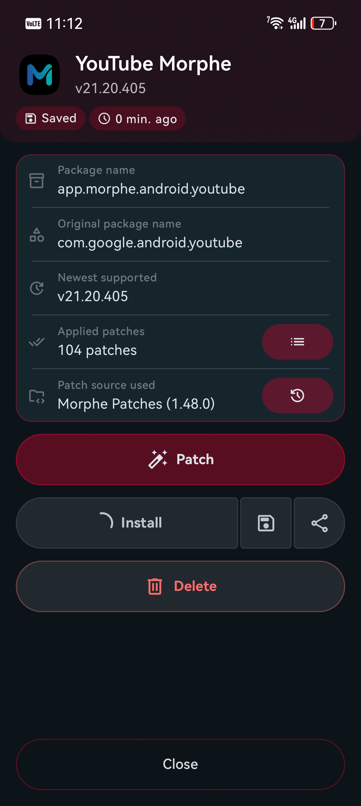{: .w-75 .shadow .rounded-10 }

On Huawei phones, the Huawei App Market takes over the install prompt. Tap **ALLOW**.

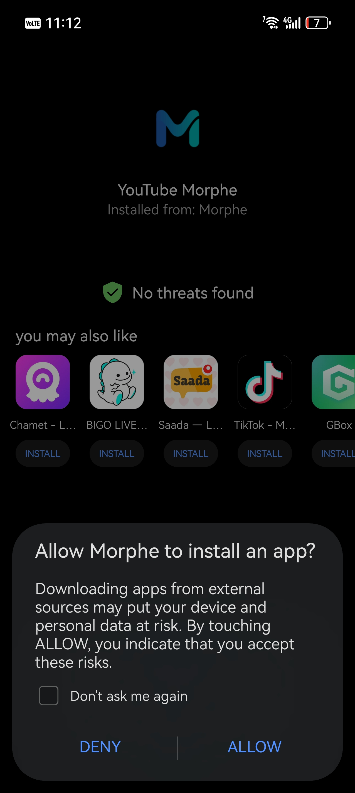{: .w-75 .shadow .rounded-10 }

If you ticked "Don't ask me again", you will not see this prompt for future patches.

When it finishes, you should have both Morphe and the patched YouTube on your home screen. The patched one uses the Morphe-style icon, so you can tell it apart from the stock app. You can change the icon in the Pached Youtube app if you want.

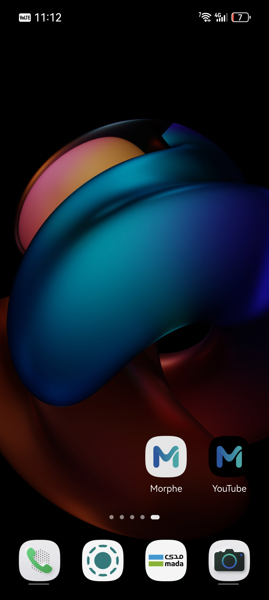{: .w-75 .shadow .rounded-10 }

## Step 5: Install MicroG RE

If you open the patched YouTube now, it will probably work for browsing, but it will not let you sign in to your Google account. This is where MicroG comes in.

MicroG is an open source replacement for Google Play Services. When Morphe patches YouTube, it re-signs the app with a different key. Google's real Play Services sees that mismatch and refuses to talk to it. MicroG sits in the middle and handles the Google sign-in and notifications instead.

When I opened YouTube the first time, I got this warning:

> The installed MicroG is not recommended by Morphe:
> `0.3.13.2.250932-hw`

That `-hw` version is the old Huawei build of MicroG that I already had on my phone from my [Huawei Google services guide](/posts/how-to-get-google-services-on-huawei/). Morphe wants its own fork, **MicroG RE**.

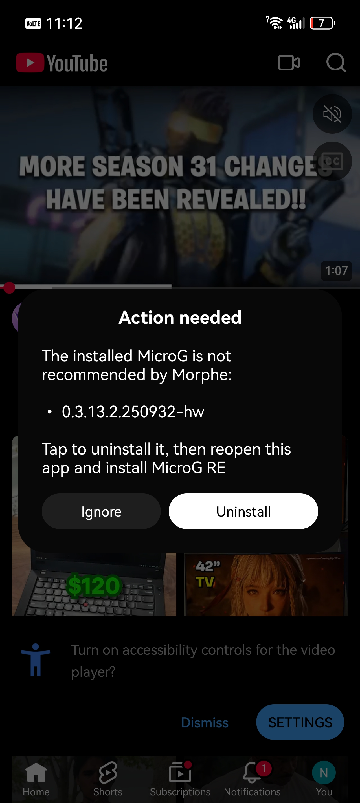{: .w-75 .shadow .rounded-10 }

Tap **Uninstall** and remove the old MicroG. Then go to [morphe.software/microg](https://morphe.software/microg) and download MicroG RE.

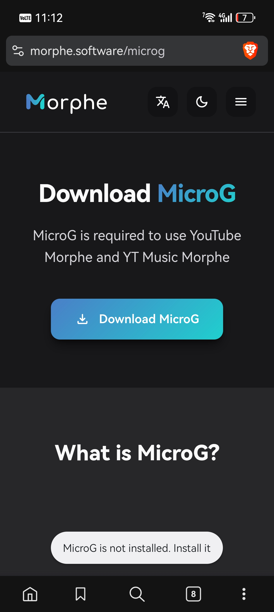{: .w-75 .shadow .rounded-10 }

The file you want is `microg-7.2.2.apk`. You can see it in my Downloads list below. 

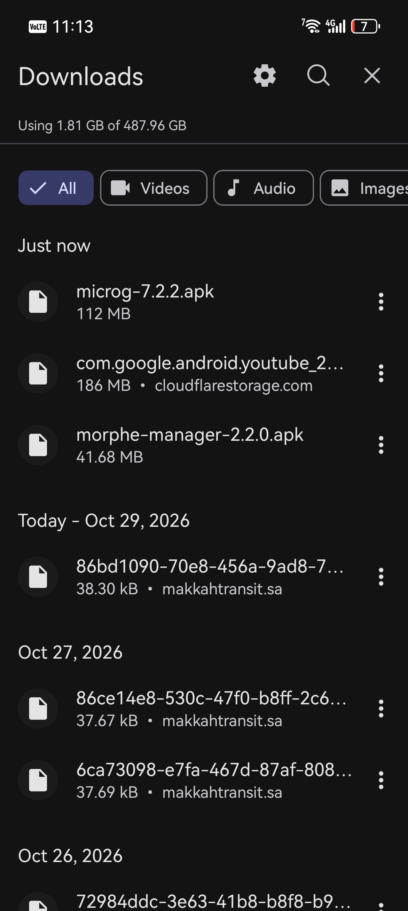{: .w-75 .shadow .rounded-10 }

Install it. Huawei App Market will check it and then you can tap **INSTALL**.

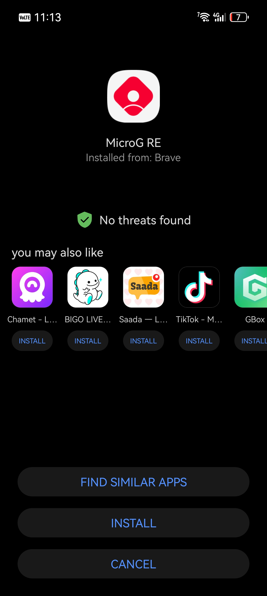{: .w-75 .shadow .rounded-10 }

## Step 6: Disable battery optimization

Open the patched YouTube again. This time it should ask you to turn off battery optimization for MicroG.

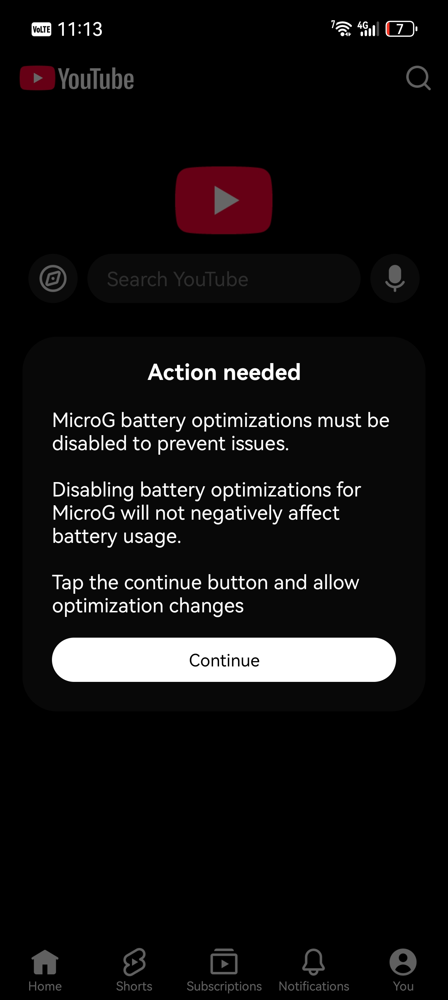{: .w-75 .shadow .rounded-10 }

Tap **Continue**, then **DISABLE** on the Android settings popup.

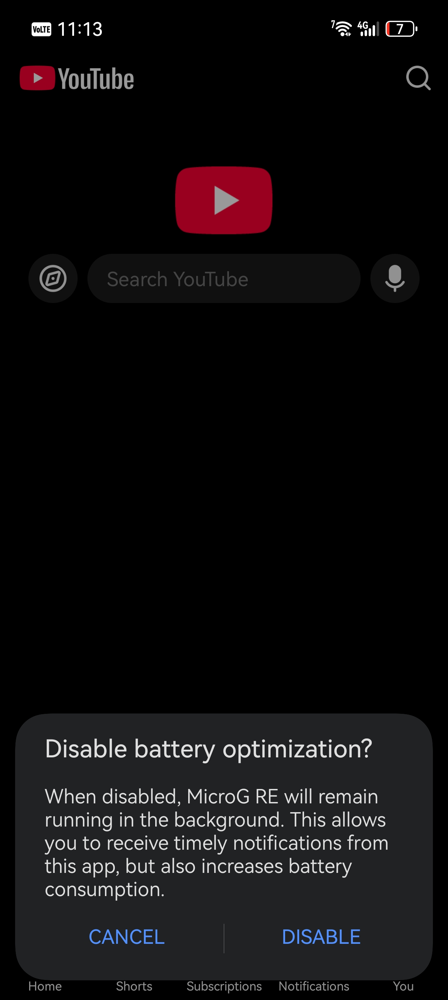{: .w-75 .shadow .rounded-10 }

It means MicroG is allowed to stay running in the background so notifications and sign-in keep working.

## Step 7: Sign in to Google

Open **MicroG RE** from your app drawer. You should now have Morphe, MicroG RE, and the patched YouTube sitting next to each other.

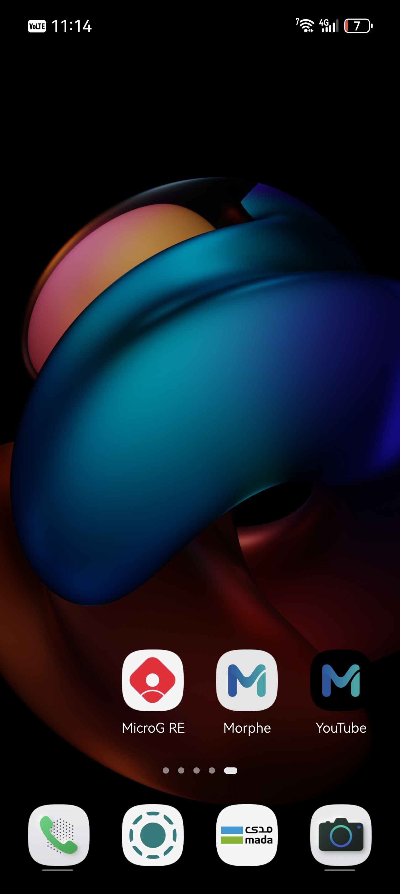{: .w-75 .shadow .rounded-10 }

Tap **Add Account**. MicroG gives you two options:

- **Sign in**: the normal Google sign-in flow
- **Huawei**: the button made for Huawei devices

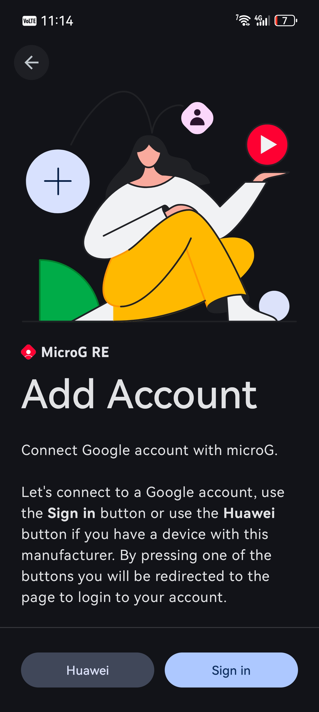{: .w-75 .shadow .rounded-10 }

After you sign in, open YouTube Morphe. Your subscriptions, playlists, and watch history should show up like normal.

## Troubleshooting

**"MicroG is not recommended by Morphe"**
You still have the old MicroG installed. Uninstall it, then install MicroG RE from [morphe.software/microg](https://morphe.software/microg).

The part that tripped me up was the old Huawei MicroG. I had it installed from a previous guide, and Morphe kept warning me about it until I removed it and installed MicroG RE. If you are coming from ReVanced on a Huawei phone, expect that..

{: .right }
